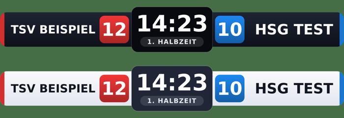

# Handball Spielstand für OBS

OBS-Plugin für Windows: Eine Kamera filmt die Hallen-Anzeigetafel, das Plugin liest **Tore, Spielzeit und Halbzeit** ab und stellt sie als fertige Grafik (Scorebug) als OBS-Quelle bereit.



## Was es macht

- **Dock "Handball Spielstand"** in OBS: Kamera auswählen, Rahmen um die Felder der Tafel ziehen, Teamnamen und -farben einstellen, Spielstand von Hand korrigieren.
- **Quelle "Handball Spielstand"**: die Grafik mit Teamnamen, Tor-Feldern in Teamfarbe, Spielzeit und Halbzeit. Wie jede andere Quelle in die Szene ziehbar und skalierbar. Zwei Designs (dunkel/hell), Schriftart wählbar.
- Die Erkennung läuft **komplett lokal** auf deinem PC. Es gibt keine Cloud, keinen Account, keine Kosten.

## Ehrlich vorweg: Das ist keine "KI"

Du hast gefragt, ob das mit KI geht. Das Plugin nutzt **klassische Bildverarbeitung für 7-Segment-Anzeigen** (die typischen LED-Ziffern in Sporthallen). Das ist schnell, braucht keine Grafikkarte und liefert bei sauberem Bild verlässliche Ergebnisse. Dafür gilt:

- Es funktioniert für **7-Segment-Ziffern** (rot, grün, weiß, auch dunkel auf hell). **Punktmatrix-Tafeln, Bildschirme mit Schriftzügen oder stark schräg gefilmte Tafeln** liest es nicht zuverlässig.
- Die Tafel muss im Kamerabild **scharf und nicht überbelichtet** sein. Die Ziffern sollten mindestens ca. 25 Pixel hoch sein.

## Installation (Windows)

1. Bei GitHub unter **Actions** den letzten erfolgreichen Lauf öffnen und das Paket `handball-scoreboard-windows-x64` herunterladen.
2. Eine der beiden Varianten wählen (OBS vorher schließen):
   - **ProgramData** (ohne Administratorrechte): Den Ordner `ProgramData\obs-studio` in dem Paket nach `C:\ProgramData\obs-studio` kopieren, sodass `C:\ProgramData\obs-studio\plugins\handball-scoreboard\bin\64bit\handball-scoreboard.dll` entsteht.
   - **OBS-Ordner**: Den Inhalt von `OBS-Installationsordner` nach `C:\Program Files\obs-studio` kopieren (Administratorrechte nötig).
3. OBS starten. Beim ersten Start erscheint das Dock **Handball Spielstand** von selbst. Es lässt sich wie jedes Dock verschieben, und über das Menü **Docks** ein- und ausblenden.

Anforderung: **OBS Studio 30 oder neuer** (64 Bit).

## Einrichten (einmal pro Halle)

1. **Kamera wählen.** Im Dock oben auswählen. Es gibt zwei Arten:
   - `Kamera: …` öffnet die Kamera direkt.
   - `OBS-Quelle: …` / `OBS-Szene: …` nutzt ein Bild, das OBS schon hat.

   > **Wichtig:** Die meisten Kameras lassen sich nur **von einem Programm gleichzeitig** öffnen. Wenn die Kamera schon als Quelle in einer Szene liegt, nimm `OBS-Quelle: <Name deiner Kameraquelle>`. Andernfalls bleibt das Bild schwarz oder leer.
2. **Tab "Tafel einrichten".** Ein Feld auswählen (z. B. *Tore Heim*) und im Kamerabild einen Rahmen um genau dieses Feld ziehen. Der Rahmen darf etwas größer sein als die Ziffern, den Doppelpunkt der Uhr darf er mit einschließen. Das Gleiche für *Tore Gast*, *Minuten*, *Sekunden* und optional *Halbzeit*.
3. An jedem Rahmen steht die **erkannte Zahl**. Steht dort ein `?`, den Rahmen neu ziehen oder die **Empfindlichkeit** ändern. Bei kursiven (schrägen) Ziffern den Wert **Schräge Ziffern** auf etwa 10 bis 20 % stellen.
4. **Anzahl Ziffern** pro Feld stimmt meist schon (Tore: 2, Minuten und Sekunden: 2, Halbzeit: 1). Bei Tafeln, die dreistellige Tore anzeigen können, auf 3 stellen.
5. **Quelle in die Szene:** *Quellen → + → Handball Spielstand*. Teamnamen und Farben stellst du im Dock im Tab **Spiel** ein.

Alle Einstellungen werden automatisch gespeichert.

## Beim Spiel

- Tore und Zeit werden automatisch von der Tafel übernommen.
- **Halbzeit:** Hat die Tafel ein Halbzeit-Feld, wird es gelesen. Sonst erkennt das Plugin die zweite Halbzeit daran, dass die Uhr nach einer (fast) vollen Halbzeit zurückspringt. Die **Halbzeitdauer** (Standard 30 Minuten) stellst du im Tab *Tafel einrichten* ein.
- **Manuell korrigieren:** Mit den Tasten −1/+1 und der Halbzeit-Auswahl. Dabei schaltet sich die Automatik für Tore und Halbzeit ab (sonst würde die Tafel den Wert wieder zurücksetzen). Wieder einschalten über das Häkchen *Tore und Halbzeit automatisch von der Tafel lesen*.
- Einzelne Lesefehler werden herausgefiltert: Ein neuer Wert wird erst nach mehreren gleichen Lesungen übernommen. Ein **sinkender** Torstand oder ein Sprung um mehr als 3 Tore braucht länger, damit ein Lesefehler nicht plötzlich den Spielstand ändert.

## Ohne Kamera ausprobieren

`docs/beispiel-tafel.png` ist das Bild einer künstlichen Tafel. In OBS als **Bildquelle** hinzufügen, im Dock `OBS-Quelle: <Name>` wählen und Rahmen ziehen.

## Selbst bauen

Der Windows-Build läuft über GitHub Actions (`.github/workflows/build.yml`). Lokal lassen sich die Erkennung und ihre Tests ohne OBS bauen:

```
cmake -S . -B build -DHB_BUILD_PLUGIN=OFF
cmake --build build
ctest --test-dir build --output-on-failure
```

Das Plugin selbst braucht libobs, obs-frontend-api und Qt6 (siehe Workflow).

## Teststand

| Was | Stand |
| --- | --- |
| Erkennung der 7-Segment-Ziffern (Rauschen, Unschärfe, Leuchtrand, Geisterbild, kursiv, verschiedene Farben) | automatisch getestet, gegen **künstlich erzeugte** Tafelbilder |
| Spielstand-Logik (Entprellen, Halbzeit, Uhr) | automatisch getestet |
| Dock, Scorebug-Quelle, Rahmen ziehen, Speichern, Live-Aktualisierung | in echtem **OBS 30 unter Linux** mit einem Testbild geprüft |
| **Windows**, echte Kamera (DirectShow) und **echte Hallentafeln** | **nicht getestet.** Der Windows-Build kommt aus GitHub Actions, die Kamerageräte-Liste und die Erkennung an einer echten Tafel konnte ich nicht ausprobieren |

Wenn eine Tafel nicht erkannt wird: Foto/Screenshot des Kamerabilds (mit sichtbaren Rahmen im Dock) sammeln, daran lässt sich die Erkennung nachschärfen.
